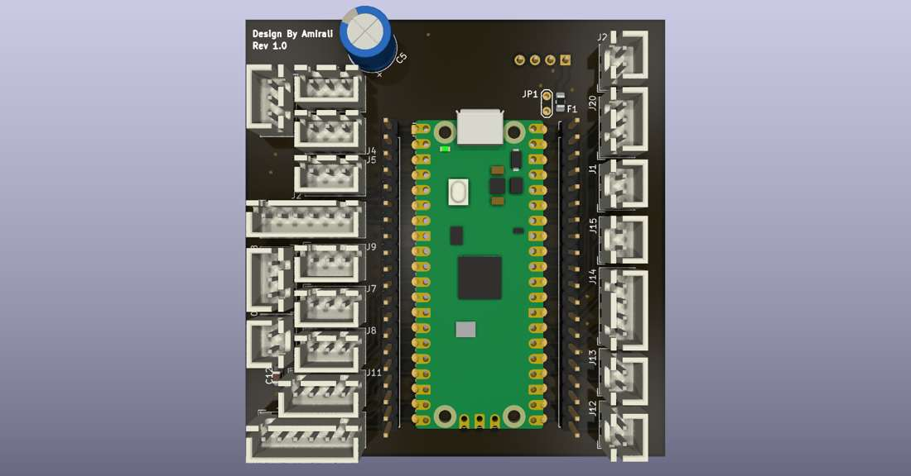
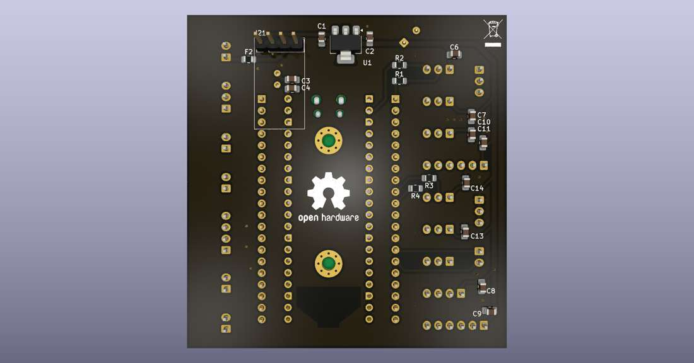
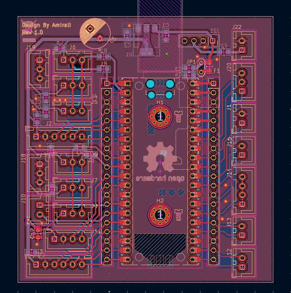

# Raspberry Pi Pico Carrier / Header Board

This directory contains the hardware design files for the custom Raspberry Pi Pico carrier/header board used in the mobile robot.

## Repository contents

```text
pico_carrier_board/
├── source/
│   ├── RP_Pico_robot.kicad_pro
│   ├── RP_Pico_robot.kicad_sch
│   └── RP_Pico_robot.kicad_pcb
├── fabrication/
│   ├── gerber/
│   │   ├── F_Cu / B_Cu
│   │   ├── F_Mask / B_Mask
│   │   ├── F_Paste / B_Paste
│   │   ├── F_Silkscreen / B_Silkscreen
│   │   ├── Edge_Cuts
│   │   └── Gerber job file
│   └── drill/
│       ├── PTH
│       └── NPTH
└── images/
    ├── pcb_3d_top.jpg
    ├── pcb_3d_bottom.jpg
    └── pcb_layout_editor.jpg
```

## Design role

The board serves as the Raspberry Pi Pico interface/carrier for the robot electronics. It breaks out Pico I/O and power rails through labeled connectors for the robot subsystems and provides the physical integration point between the RP2040 controller and the low-level electronics.

The editable KiCad project under `source/` is the authoritative design source. The Gerber and drill files are manufacturing outputs generated from this design snapshot.

## Design views

### Top-side 3D render



### Bottom-side 3D render



### PCB Editor layout



## Fabrication snapshot

The supplied Gerber and drill outputs were generated by **KiCad/Pcbnew 10.0.3** on **2026-09-11**.

Before ordering a new production batch:

1. Open the editable KiCad project.
2. Run ERC/DRC.
3. Verify footprints and connector orientation against the assembled hardware.
4. Regenerate Gerber and drill files if the source design has changed.

## Thesis appendix

For the thesis appendix, the most useful figures are the PCB Editor layout plus the top and bottom 3D renders. The complete KiCad source and manufacturing outputs remain in the repository so the board can be inspected independently of the thesis document.

