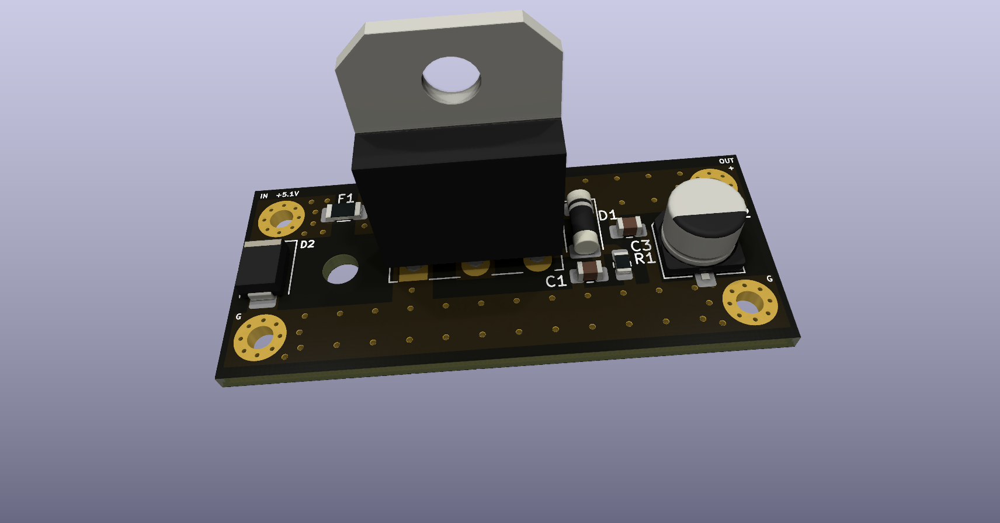
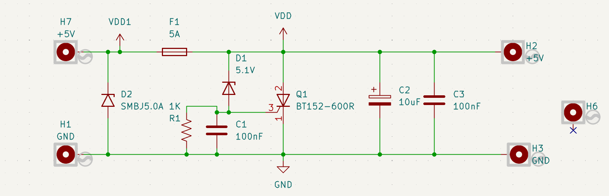

# Raspberry Pi 5 Overvoltage Protection Board

This directory contains the KiCad design sources, manufacturing outputs, and design views for the custom Raspberry Pi 5 power-protection board used in the mobile robot.

## Purpose

The board is intended to protect the Raspberry Pi 5 supply rail against an overvoltage event around the 5.1 V threshold. The submitted schematic uses a 5.1 V Zener-triggered crowbar-style protection stage together with a 5 A input fuse and transient suppression.

The editable KiCad source is the authoritative design record. The Gerber and drill files are a fabrication snapshot generated from that design.

## Repository contents

```text
raspberry_pi5_overvoltage_protection/
├── source/
│   ├── RP_robot.kicad_pro
│   ├── RP_robot.kicad_sch
│   └── RP_robot.kicad_pcb
├── fabrication/
│   ├── gerber/
│   │   ├── F_Cu / B_Cu
│   │   ├── F_Mask / B_Mask
│   │   ├── F_Paste / B_Paste
│   │   ├── F_Silkscreen / B_Silkscreen
│   │   ├── Edge_Cuts
│   │   └── Gerber job file
│   └── drill/
│       ├── PTH
│       └── NPTH
└── images/
    ├── pcb_3d_top.png
    └── schematic_view.png
```

## Design views

### 3D PCB render



### Schematic view



## Notes

The schematic snapshot includes the 5.1 V Zener threshold element, a 5 A fuse, an SMBJ5.0A TVS device, and thyristor-based protection devices. Actual trip voltage and fault-clearing behavior depend on component tolerances, fuse characteristics, wiring resistance, and the upstream power source; these should be verified on the physical board before relying on the circuit as the sole protection mechanism.

## Thesis appendix

For the thesis appendix, the schematic view and 3D PCB render are the most useful visual artifacts. The complete KiCad and manufacturing files are preserved here for reproducibility.

## Pending documentation

A structured BOM and any final assembly/fabrication notes can be added when finalized.
