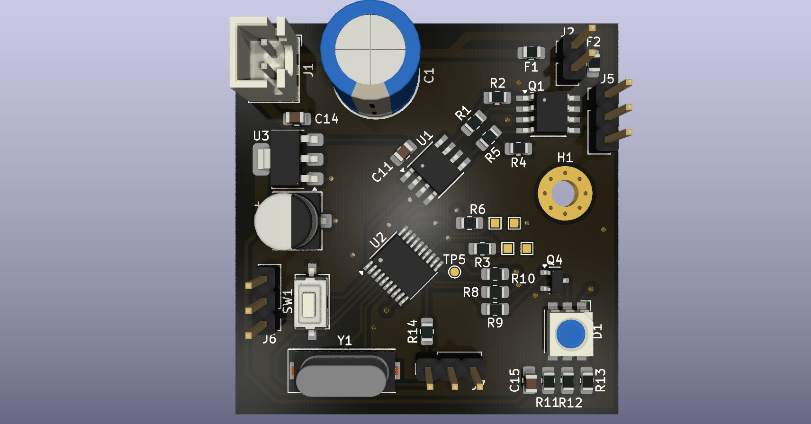

# STM8 Dual-Channel Temperature and Fan Controller

A custom thermal-management PCB for the autonomous mobile robot, based on the STM8S003F3P microcontroller.

## Hardware capabilities
- Two analog NTC thermistor inputs (ADC2 and ADC3).
- Two independently driven PWM fan channels (TIM2_CH1, TIM2_CH2), with TC4428A gate driver and Si9945BDY MOSFET switching stage.
- RGB status indicator driven through transistor stages (TIM1_CH1–CH3), supporting mixed colors.
- UART RX/TX connector for planned communication with the main Raspberry Pi Pico controller.
- SWIM/NRST programming connector.
- 5 V input and AMS1117-3.3 regulator for the logic rail.

## Thesis implementation status

**Hardware designed, fabricated, and mounted on the robot; not used as an active subsystem in the thesis experiments.** The schematics and PCB demonstrate the proposed thermal-management interface, but the board's actual temperature-feedback control, fan PWM response, UART exchange with the Pico, and RGB state logic must **not** be described as experimentally validated. The design repository documents the board at schematic and PCB level; active firmware-level operation is outside the reported experimental evaluation.

## Files

- `source/Fan_robot_V3.kicad_pro`: KiCad project settings.
- `source/Fan_robot_V3.kicad_sch`: Editable schematic.
- `source/Fan_robot_V3.kicad_pcb`: Editable PCB layout.
- `schematic/Fan_robot_V3.pdf`: One-page schematic for independent viewing.
- `images/pcb_3d_top.jpg`: 3D PCB render.

### PCB 3D render

### Schematic

[View schematic PDF](schematic/Fan_robot_V3.pdf)

## Fabrication and verification

Review footprints, connections, and thermal/power ratings using the schematic and PCB, and run ERC/DRC before fabrication. This documentation describes the circuit design and its installed role, not a measured closed-loop thermal-control performance.
